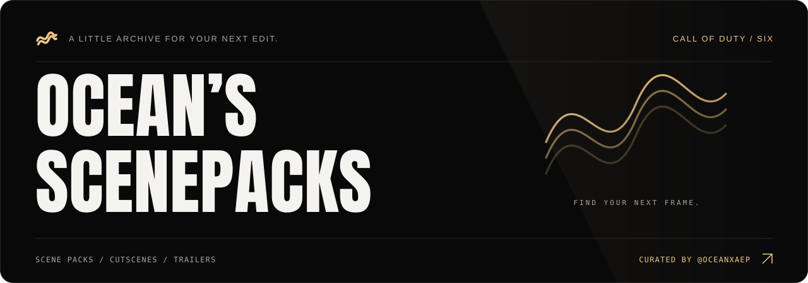
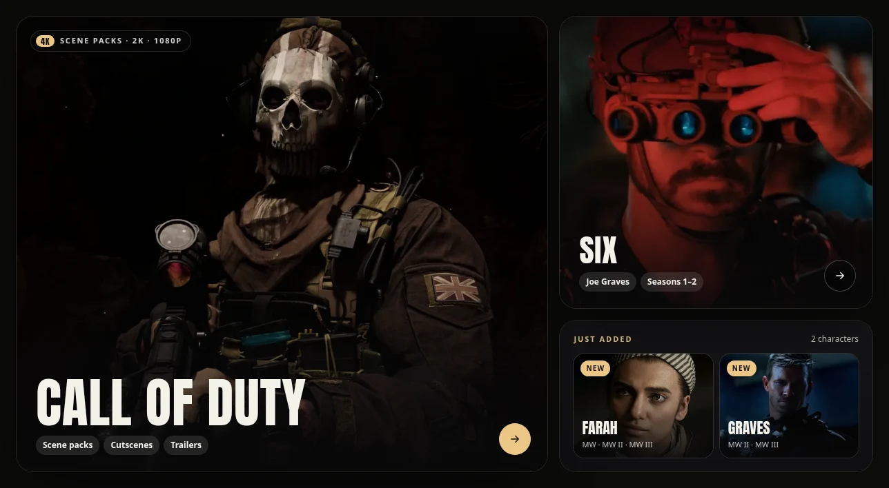

  <a href="https://qstrx.github.io/noctis/"><strong>Browse the packs</strong></a>
  &nbsp; · &nbsp;
  <a href="https://qstrx.github.io/noctis/quality.html">Quality guide</a>
  &nbsp; · &nbsp;
  <a href="https://github.com/Qstrx/noctis/issues/new/choose">Leave a note</a>

  Hi! Here are my Call of Duty and SIX scene packs.

 

## Collections

| Call of Duty | SIX |
| :--- | :--- |
| Character packs, cutscenes, gameplay and trailers. | Joe Graves · Seasons 1–2. |
| [Browse Call of Duty](https://qstrx.github.io/noctis/cod.html) | [Browse SIX](https://qstrx.github.io/noctis/six.html) |

 

Working on the site?

The [project notes](.github/notes/README.md) cover setup, maintenance and artwork sources. If you’d like to help, start with the [contribution guide](.github/CONTRIBUTING.md).

 

---

  If you use a pack, please credit <a href="https://www.tiktok.com/@oceanxaep"><strong>@oceanxaep</strong></a>. Thank you!

